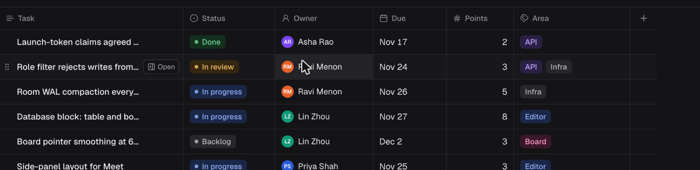
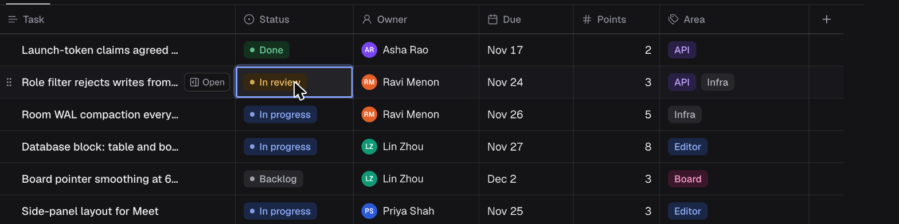
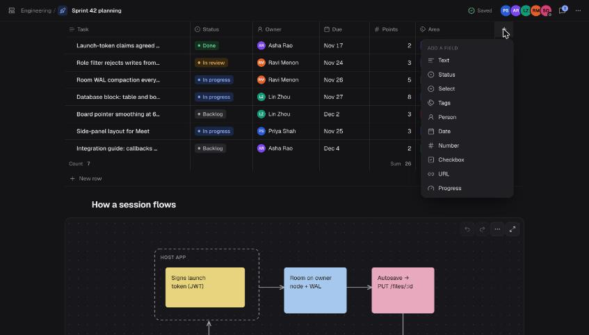
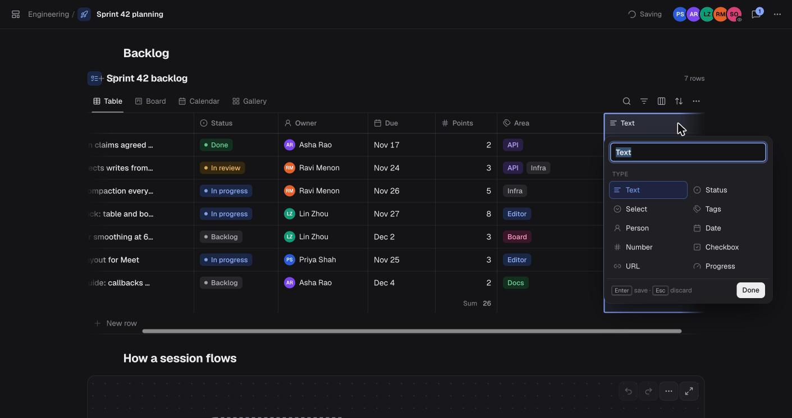
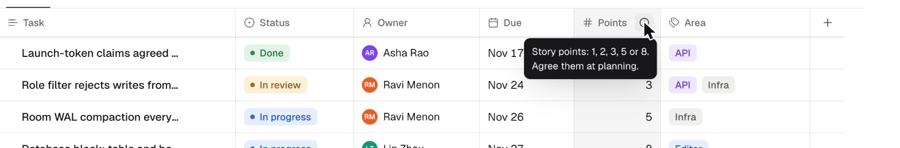
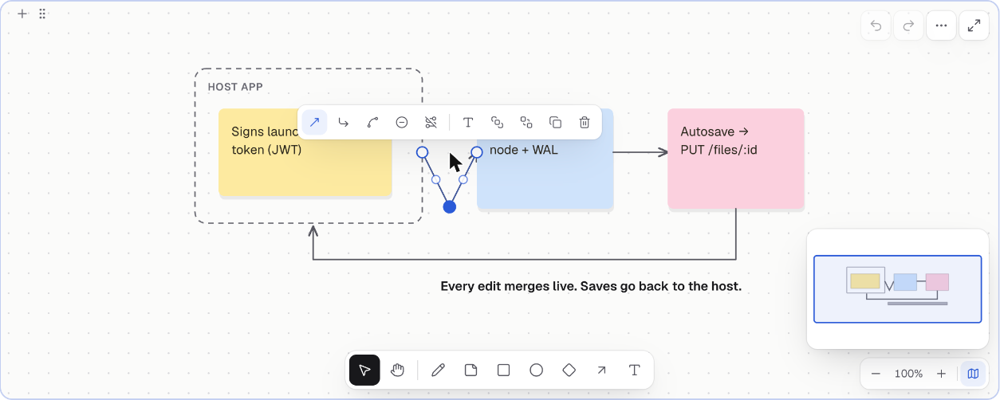

# 20 — Database and board blocks: UX audit

Date: 2026-11-21. Scope: `web/packages/database`, `web/packages/board` (React 19 + Yjs).
Bar: premium, production-grade collaborative tools. WCAG 2.2 AA, including 2.5.7 (a single-pointer
or keyboard alternative for every drag). Lucide icons only.

## Method

- A temporary Vite harness mounted both blocks twice, on two `Y.Doc`s synced in memory (with two
  `Awareness` instances), to act as two users. It was deleted before committing.
- Playwright (headless Chromium) at 1440 px and 390 px, light and dark: screenshots, scripted
  keyboard and pointer runs, and timings with 1,000 database rows and 2,000 board shapes.
- Every behavioural fix has a vitest test (`database/src/ux.test.tsx`, `board/src/ux.test.tsx`).
  The UI tests were run against the previous `DatabaseBlock.tsx` / `BoardBlock.tsx` and all failed.

### Measurements (headless Chromium, M-series laptop)

| Case | Before | After |
|---|---|---|
| Database, 1,000 rows: rows in the DOM | 1,007 | 38 (virtualised) |
| Database, 1,000 rows: 10 remote cell edits, one frame each | 8,630 ms | 165 ms |
| Board, 2,000 shapes: 30 pan moves | 1,211 ms | 640 ms (499 ms zoomed in) |
| Board, 2,000 shapes zoomed in: shapes in the DOM | 2,011 | 88 (culled) |

Severity: **Critical** blocks a task or a user group; **High** a core workflow missing or broken;
**Medium** clearly below the bar; **Low** polish. Status: Fixed, Open, By design.

## Database block

| # | Issue | Severity | Status |
|---|---|---|---|
| D1 | Every edit re-rendered every row; 1,000 rows took ~860 ms per edit and kept 1,000+ rows in the DOM. Now: table body is virtualised past 80 rows (spacer rows, `aria-rowcount`), rows are memoised and unchanged rows keep their objects between snapshots, `people` no longer changes on every edit. | Critical | Fixed |
| D2 | No spreadsheet keyboard model. Now: arrows move between cells (left/right leave a text cell only at the caret's edge), Enter commits and moves down, Home/End, Ctrl+arrows / Ctrl+Home/End jump to edges, PageUp/PageDown, typing on an option/person/date cell opens its editor. | High | Fixed |
| D3 | No cell ranges or clipboard. Now: Shift+arrows, Shift+click and click-drag select a range; Ctrl+C/X copy TSV + HTML (Excel/Sheets compatible); Ctrl+V pastes a block (types converted, unknown options added, rows added when needed) or fills a range with one value; Delete clears; Escape collapses. | High | Fixed |
| D4 | A field's type could not be changed. Now: header menu → Type; values are converted through their text form; title stays title. | High | Fixed |
| D5 | Status / select / tags options could only be created from a cell. Now: options editor (rename — cells follow, recolour, reorder with up/down buttons, delete — cells cleared, add). | High | Fixed |
| D6 | Ctrl+Z did nothing in the database (only delete toasts had Undo). Now: per-user `Y.UndoManager` on the database; text fields keep native undo while focused; remote edits are never undone. | High | Fixed |
| D7 | Column widths were fixed. Now: drag the column edge, or focus it (a `separator` with value) and use arrow keys; Home resets; double-click resets. Stored per view as `widths`. | High | Fixed |
| D8 | Columns could not be reordered. Now: drag a header (mouse), Alt+Shift+←/→ on a header, or Move left/right in its menu. | Medium | Fixed |
| D9 | Table rows could not be reordered (kanban only). Now: grip handle (drag, or arrow keys while focused) and Alt+Shift+↑/↓ from any cell; refused with a message while a sort is active. | Medium | Fixed |
| D10 | One sort key and one filter field only. Now: several sort keys (direction, reorder, remove), filters on several fields combined with AND, "Empty" as a filter value. `sort`/`filter` still mirror the first rule for older clients. | Medium | Fixed |
| D11 | Search had no highlight. Now: matches are marked in rendered values (pills, people, dates, numbers, URLs, gallery titles); editable text cells that match get an underline. | Medium | Fixed |
| D12 | Board view always grouped by the first status field, calendar always used the first date, gallery cover was fixed. Now: View settings — group by, date field, card cover (group colour, none, or an image from a URL field). | Medium | Fixed |
| D13 | Row peek: no previous/next, focus not moved in or restored, no dialog semantics. Now: "n of N" with previous/next buttons, J/K and Alt+↑/↓ (follow the view's filter/sort), focus moves into the panel and back to the opener, `role="dialog"`. | Medium | Fixed |
| D14 | A CSV import could not be undone. Now: the toast's Undo (and Ctrl+Z) removes the rows and any fields the import added. | Medium | Fixed |
| D15 | Empty states: "No rows yet" sat under the New row button; board/calendar said "Add a field" with no way to do it. Now: proper empty states with New row / Import CSV and one-click "Add a Status / Date field". | Medium | Fixed |
| D16 | The search button focused the field after a 30 ms timer, so the first keystrokes were lost. | Low | Fixed |
| D17 | On macOS, Home/End in a cell scrolled the whole page (found when the virtualised table jumped). Now they move the caret on every platform. | Low | Fixed |
| D18 | A focused cell kept a stale draft while a collaborator edited it, and blurring could write the stale value back without any typing. `CommitInput` now commits only real edits and follows the shared value while untouched. | Low | Fixed |
| D19 | Adding a field only toasted "Click its header to rename it". It now opens the new field's menu with the name selected. | Low | Fixed |
| D20 | Sort / filter chips could only be removed. They now open their popover to edit. | Low | Fixed |
| D21 | Filters only covered option-like fields (status, select, tags, person, checkbox): no "text contains", number ranges or date before/after. Now typed conditions per field type (text contains / is / is empty; number = ≠ < ≤ > ≥ between, is empty; date is / before / after / within the next or past N days / is empty; checkbox is / is not checked), ANDed, stored in the view settings (shared), one editable, removable chip each; unfinished rules show as dashed chips and filter nothing. | Medium | Fixed |
| D22 | No per-view hide/show of fields. Now a Fields menu per view: a switch per field (the title can't be hidden), reorder by dragging the grip, its arrow keys or up / down buttons; "Hide in this view" in the column menu; board and gallery cards leave hidden fields out. | Medium | Fixed |
| D23 | Calendar items couldn't be dragged to another day. Now: drag (mouse; long-press 250 ms on touch) with a ghost and the target day highlighted; Alt+←/→ moves a focused item a day, Alt+↑/↓ a week (focus stays on it, the month follows, the move is announced); a "No date" tray lists undated rows (drag onto a day, or Alt+arrow puts one on today); drop on the tray (or Alt+Backspace) clears the date; double-click a day adds an item there. | Medium | Fixed |
| D24 | `moveField` re-creates the field's Y.Map (Yjs can't move nested types): a rename by someone else at the same instant was lost. Column moves (drag, Alt+Shift+arrows, menu, Fields menu) now write the view's `fields` order instead; the UI no longer calls `moveField`. | Low | Fixed |
| D25 | Search highlight inside an editable input is an underline, not a mark on the matched text. | Low | Open |
| D26 | Header drag-to-reorder is mouse-only; touch uses the menu items. | Low | By design |
| D27 | Gallery image covers load the URL directly (referrer stripped, lazy). They should go through the server's SSRF-safe fetcher. | Low | Open |
| D28 | The header showed "7 rows" under the editor's block handle on hover (docs/19 #43). The handle is anchored to the text column's left edge, which on a wide block falls inside the header right after a short name. The count now sits at the far right of the header. Editor follow-up: anchor the handle to a wide block's own left edge (it still overlaps the database icon). | Low | Fixed (block side) |
| D29 | Adding a field opened a type list, then the column menu; the new column was easy to miss and couldn't be cancelled. Now `+` (a 28 px target with a hover tint and the tooltip "Add a field") and Insert left / right in the column menu add a Text field, scroll it into view and flash the whole column (accent tint + 2 px accent outline, fading over 1.2 s; static under reduced motion), and open its name selected with the type picker under it (a name nobody typed follows the type). Enter or Done keeps it, Esc removes the brand-new field; focus returns to its header (to `+` after Esc). | High | Fixed |
| D30 | Borders and highlights: the selected cell's ring was a 28 % alpha inset shadow (about 1.6:1), painted under the cell's button; closing any popover (a cell editor, Esc) dropped focus to `<body>`, so the cell lost its ring and keyboard users their place; the compact sticky first column drew its border twice (border + shadow); the header bottom used the faintest hairline. Now a 2 px accent ring drawn above the cell content inside the cell (never clipped by the scroller; 5.9:1 light, 7.8:1 dark); every popover gives focus back to what opened it; one 1 px hairline everywhere, `--line-2` under the header; hovering a header tints its column, the column being resized or dragged gets accent edges. | Medium | Fixed |
| D31 | No way to note what a field means. Fields take an optional `description` (shared field map): column menu "Add / Edit description" (multi-line; Ctrl+Enter or Save keeps it, Esc cancels, Remove clears), an info button in the header with a tooltip on hover and focus (the header button and the info button both point at it with `aria-describedby`), the note under the field name in the row peek, a footnote line under the table in Markdown (web and server), kept in `document.json`, not in CSV. | Medium | Fixed |
| D32 | Ctrl+Z inside the database did nothing in the real editor: the guard skipped any target with a `contenteditable` ancestor, and the editor document is one. It now skips only editable elements inside the block. | High | Fixed |
| D33 | Sample data named real companies' products (a word processor brand, a well-known sample-database brand). Now Acme placeholders. | Low | Fixed |

## Board block

| # | Issue | Severity | Status |
|---|---|---|---|
| B1 | The board root had `tabIndex=-1`: keyboard users could not reach the canvas or select anything. Now: focusable group with a description; Tab/Shift+Tab walk the shapes (and leave the board after the last); a live region announces the selection ("Rectangle: B. 2 of 13"). | Critical | Fixed |
| B2 | Single selection only. Now: box select on empty canvas (mouse/pen), Shift+click to add/remove, Shift+box to add, Ctrl+A; multi-shape move, nudge and delete. | High | Fixed |
| B3 | No copy/paste of shapes (Ctrl+D duplicated one shape). Now: Ctrl+C/X/V through the system clipboard (HTML payload, works across boards), pasted next to the originals or in the view's centre, connector bindings and groups remapped to the copies; pasting plain text makes a text shape or sticky; Ctrl+D duplicates the selection. | High | Fixed |
| B4 | No grouping. Now: Ctrl+G / Ctrl+Shift+G and toolbar buttons; clicking any member selects the group. | High | Fixed |
| B5 | No align / distribute. Now: align left/centre/right/top/middle/bottom and distribute horizontally/vertically (3+) from the selection toolbar; bound connectors follow. | High | Fixed |
| B6 | No snapping. Now: moving snaps the selection's edges and centres to other shapes with pink guides; Alt moves freely. | Medium | Fixed |
| B7 | Sticky text did not wrap and overflowed the note; notes never grew. Now: text wraps; the note grows while typing and keeps the new height on commit. Rectangle, ellipse and diamond text wraps too. | High | Fixed |
| B8 | Connectors had no labels. Now: Enter or double-click edits a label in place at the connector's midpoint. (Since B20, double-clicking the line adds a waypoint; double-click the label, press Enter, or use Edit label.) | Medium | Fixed |
| B9 | Rectangles, ellipses and diamonds had no fill colour; text size was fixed. Now: none + 7 tone fills (outline follows), text size cycle for text and shapes. | Medium | Fixed |
| B10 | Layer order couldn't be changed (`bringToFront` existed but was unused). Now: front/back buttons, Ctrl+] / Ctrl+[ (forward/backward), with Shift for front/back. | Medium | Fixed |
| B11 | No undo/redo buttons, so touch users had no undo. Now in the top bar, disabled when empty. | Medium | Fixed |
| B12 | Collaborators' selections were invisible. Now: awareness `board.sel`; their selection is outlined in their colour with a name tag. | Medium | Fixed |
| B13 | With 2,000 shapes every pointer move re-rendered every shape. Now: memoised shapes with stable objects and viewport culling above 300 shapes (see measurements). | Medium | Fixed |
| B14 | WCAG 2.5.7: drags had no alternative except moving. Now: Alt+arrows resize; tool key + Enter places a shape in the view's centre; Connect button (or arrow tool + Enter) joins two selected shapes; arrows nudge (Shift ×10). | High | Fixed |
| B15 | Zoom limited to 25–300 %, so large boards could not be fitted. Now 10–400 %; Shift+1 fit, Shift+2 zoom to selection, Shift+0 / Ctrl+0 100 % around the centre. | Low | Fixed |
| B16 | Dragging on empty canvas panned, leaving no way to box-select. Now box-select; pan with Space+drag, the hand tool, the middle button, or one finger on touch; two fingers pinch and pan. | Low | Fixed |
| B17 | Escape with a creation tool active did nothing; it now returns to Select. | Low | Fixed |
| B18 | PNG/SVG export (web `export.ts`, and the Rust port EXP-02) did not draw the new fills, connector labels, text wrapping or shape text sizes. Now both draw tone fills/outlines, text sizes, wrapped text, auto-grown stickies and connector label pills, byte-identical on the shared fixture (EXP-03). | Medium | Fixed |
| B19 | No minimap. Now a toggleable minimap (M, or the map button in the zoom bar): every shape drawn small, the visible area outlined; click jumps there, drag the outline (or keep dragging after the click) to pan, arrow keys pan from the focused map (Shift for big steps), Home centres the board. Shift+1 / Shift+2 fit the board / the selection (B15). | Low | Fixed |
| B20 | Connectors routed straight or elbow only; no manual waypoints. Now arrow `via` waypoints on straight and elbow connectors: double-click the line adds one there, double-click a waypoint removes it, drag to move, drag a segment's + handle to insert; keyboard: W adds one (middle of the longest segment), Alt+←/→ picks one, arrows move it (Shift ×10), Delete removes it, Escape returns to the connector; toolbar Add / Remove / Clear waypoints. Bound ends keep following their shapes; both exporters draw the path (shared fixture). | Medium | Fixed |
| B21 | No rotation; no stroke colour or width separate from the fill. | Low | Open |
| B22 | Freehand pen has no keyboard alternative: the path is the content (2.5.7 "essential" exception). | Low | By design |
| B23 | Snapping is skipped above 1,500 shapes to keep moves smooth. | Low | Open |
| B24 | Every board shortcut (Tab, arrows, Delete, W, undo, zoom keys) was dead inside the editor: the keydown guard bailed on any `contenteditable` ancestor (found while checking B20 in the editor demo). It now ignores only editable elements inside the board. | Critical | Fixed |
| B25 | Board undo was separate from the canvas undo (docs/19 #42). With `env.undoManager` the board adds its map to the editor's `Y.UndoManager` and tracks its view origin there (and stops tracking on unmount, never destroying it); without one it keeps its own. Moves that re-sync bound connectors are one transaction, so one undo step. The database does the same. The editor still has to pass the manager. | Low | Fixed (block side) |

## Open-items pass (2026-11-21)

Closed D21–D24, B19, B20, the board-undo item (docs/19 #42) and the "7 rows" header (docs/19 #43).
Then, on user feedback about adding columns, D29–D31; checking in the editor demo found D30's focus
loss, D32 and B24. Every fix has a test that was run against the old code and seen failing:
`database/src/views.test.tsx` (17), `database/src/addfield.test.tsx` (9), `board/src/open.test.tsx`
(17; the Shift+1 / Shift+2 test already passed, B15), Rust `elbow_via`, the extended shared fixture and
`markdown_lists_field_descriptions_under_the_table`. Checked by hand in Chrome in the editor's
`#demo` (dev server only, nothing added to the repo), light and dark.

| | Before | After |
|---|---|---|
| Grid, selected cell (dark) |  |  |
| Adding a field |  |  |
| Field description (light) | — |  |
| Waypoint + minimap (light) | — |  |

Contrast (WCAG 2.2 1.4.11): the cell focus ring is `--accent` on `--app`, 5.9:1 light and 7.8:1 dark
(it was a 28 % alpha tint, about 1.6:1). The new-column outline, the drag / resize edges and the
active waypoint use the same accent. The add-field button's icon is `--fg-2` (7.4:1 light) and turns
accent on hover. Grid hairlines stay at `--line` (about 1.3:1) and `--line-2` under the header
(about 1.4:1): they separate cells but aren't needed to identify or operate anything (each cell is its
own control with its own focus ring), so 1.4.11 doesn't apply; raising them to 3:1 would make the grid
heavy. Tooltips are `--app` text on `--fg`.

Calendar drag and the minimap outline were checked with real pointer events in Chrome; the browser
extension's synthetic drag sends no intermediate moves, so it can't exercise them.

## Contract notes (follow-up outside this session's files)

Open-items pass: recorded in docs/15 §4 and ADR-025, all optional and additive: arrow `via`; field
`description`; view prefs `fields`, `hidden` and typed `filters` rules (`{f, op, v, v2}`);
`BlockEnv.undoManager`. **Editor follow-ups:** pass `undoManager` to both blocks; anchor the block
handle to a wide block's own left edge (D28).

Earlier pass:

Done: recorded in docs/15 §4 and ADR-024. The changes are additive and old clients ignore them:

- Board shapes: `group` (string), arrow `text` (label), `fill` on rect/ellipse/diamond (a tone name),
  `size` on rect/ellipse/diamond (text size).
- Board awareness: `board.sel` (selected shape ids) next to `board.x`/`board.y`; `board` may carry
  only `sel` when the pointer is outside the board.
- Database view prefs: `sorts`, `filters` (with `sort`/`filter` mirroring the first rule), `widths`,
  `group`, `date`, `cover`.

## API additions

- `@opencanvas/database` (internal modules, not re-exported): `setFieldType`, `setOptions`,
  `moveField`, `pasteCells`, `clearCells`, `OPTION_TYPES` (model); `sortsOf`, `filtersOf`,
  `sortPatch`, `filterPatch`, `highlightParts` (query); `grid.ts` (range, TSV, navigation helpers).
  Types gain `SortRule`, `FilterRule` and the `ViewPrefs` keys above. `groupField`, `dateField` and
  `defaultMonth` take an optional prefs argument.
- `@opencanvas/board`: `ops.ts` (align, distribute, snap, clone, z-order, groups, wrap; not
  re-exported); `Shape.group`.
- No exported signature changed; `web/packages/ui` is untouched.

Open-items pass:

- `@opencanvas/ui`: `BlockEnv.undoManager?: import("yjs").UndoManager` (additive).
- `@opencanvas/database`: `DbField.description`; `FilterRule` gains `op`, `v`, `v2` (`vals` now
  optional) and the `FilterOp` type; `ViewPrefs.fields`, `ViewPrefs.hidden`. Internal (not
  re-exported): `setFieldDescription` (model); `filterOps`, `ruleReady`, `rulesOf`, `matchRule`,
  `filterLabel`, `OP_LABEL`, `orderedFields`, `viewFields` (query); `visibleRows` takes an optional
  `now`; `Pop` takes `onEscape` and returns focus to its anchor.
- `@opencanvas/board`: `Shape.via`; `connectors.ts` exports `elbowVia` and `viaOf` (not re-exported
  from the package index); `movePatch` moves `via` too.
- Rust `oc_model`: no public API change (board `via`, Markdown field notes are internal).
