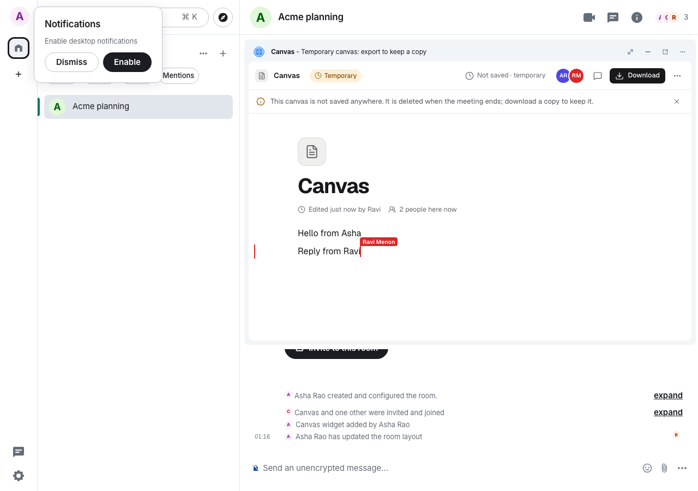

<!-- SPDX-License-Identifier: Apache-2.0 -->
<!-- Copyright 2026 CasualOffice -->

# OpenCanvas in Matrix rooms (Element)

The canvas is a room widget, like Etherpad or Jitsi in Element. Everyone in the room opens the
same canvas from the widget bar and edits it live. A small bridge service is the OpenCanvas
host for Matrix.

- **Identity is checked, not taken from the URL.** The widget asks the Matrix client for an
  OpenID token, and the bridge confirms it with the user's own homeserver.
- **Only room members can open it.** A bot account reads the room's membership and power
  levels. Moderators (power level ≥ `state_default`) edit; everyone else gets
  `MX_MEMBER_ROLE` (default `edit`).
- **Leaving the room ends access.** When someone leaves, is kicked or is banned, the bot closes
  their open canvas right away through the OpenCanvas role API.
- **Names come from Matrix.** People appear under their room display names; the Matrix user id
  is the second line that tells two people with the same name apart.
- **The canvas is temporary.** It is deleted once everyone has left it and the idle grace has
  passed. People download or export it (PDF, Word, Markdown, `.ocanvas`) to keep it.
  Canvases stored in Matrix are planned for phase 2.
- **It is not end-to-end encrypted**, even in encrypted rooms (see Limits).



## How it works

1. A room admin adds a widget state event (`im.vector.modular.widgets`) whose URL points at
   the bridge: `https://canvas-bridge.acme.example/widget?roomId=$matrix_room_id&wid=$matrix_widget_id`.
2. Element shows its own prompts: first "Widget added by …" consent for widgets added by
   someone else, then "Allow this widget to verify your identity".
3. The widget page (`bridge/public/`) answers Element's widget API handshake (it asks for no
   capabilities), requests an OpenID token (`get_openid`), and posts it to the bridge.
4. The bridge finds the user's homeserver by the Matrix server-name rules (`.well-known`, SRV,
   port 8448). It refuses any route that leads to a private, loopback or link-local address.
   It then calls `GET /_matrix/federation/v1/openid/userinfo` and accepts the answer only if
   the user belongs to that server.
5. The bot checks four things: it is still joined itself, the user is joined, the widget is in
   the room and points at this bridge, and the user's power level (which sets the role).
6. The bridge signs a 10-minute, single-use OpenCanvas launch token (HS256, `aud="opencanvas"`,
   `jti`). The canvas id is an opaque hash of room id and widget id, so OpenCanvas never sees
   the room id. The widget posts the token into a nested frame, so it never appears in a URL.
7. OpenCanvas opens the editor at `/app/?h=<host id>`. That page is allowed to be framed by the
   host's `frame_ancestors` (the Matrix client origins) and the bridge origin.

Design and research, with sources: [DESIGN.md](DESIGN.md). Screens still waiting for a
prototype: [UI-SCREENS.md](UI-SCREENS.md).

## Install

You need OpenCanvas 0.1.1 or later with per-host `frame_ancestors` (releases after 0.1.1 for
`temporary_wording`; older ones keep meeting wording), Node 24 for the bridge,
and a Matrix bot account.

1. **Bot account** on your homeserver, for example `@canvasbot:acme.example`. Log in once to
   get its access token and keep the token secret. The bot only reads room state; it never
   sends messages.
2. **OpenCanvas** `hosts.toml`:
   ```toml
   [[host]]
   id              = "acme-matrix"
   name            = "Matrix"
   mode            = "jwt"
   jwt_alg         = "HS256"
   jwt_secret      = "env:ACME_MATRIX_OC_SECRET"     # openssl rand -hex 32
   api_key         = "env:ACME_MATRIX_OC_API_KEY"    # openssl rand -hex 32
   storage         = "ephemeral"
   allowed_origins = ["https://canvas-bridge.acme.example"]
   # Every Matrix client origin your users open the widget from. They apply to this host's
   # editor only, not to the rest of the server.
   frame_ancestors = ["https://element.acme.example", "https://app.element.io"]
   [host.flags]
   temporary_wording = "room"   # room wording in the editor, "Start a new canvas" when it ends
   export_formats  = ["md", "html", "docx", "pdf", "ocanvas", "png"]
   ```
3. **Bridge**: run it behind TLS, on its own origin.
   ```sh
   cd integrations/matrix/bridge
   PORT=8090 \
   MX_PUBLIC_URL=https://canvas-bridge.acme.example \
   OC_URL=https://canvas.acme.example \
   OC_HOST_ID=acme-matrix \
   OC_JWT_SECRET=<jwt_secret> \
   OC_API_KEY=<api_key> \
   MX_BOT_HOMESERVER_URL=https://matrix.acme.example \
   MX_BOT_ACCESS_TOKEN=<bot token> \
   MX_ALLOWED_SERVERS=acme.example \
   MX_BOT_AUTOJOIN=1 \
   node src/server.mjs
   ```

## Configure

| Variable | Meaning |
|---|---|
| `PORT` | listen port (default 8090) |
| `MX_PUBLIC_URL` | the bridge's public URL; widget URLs must be `<MX_PUBLIC_URL>/widget?…` |
| `OC_URL` | OpenCanvas as browsers reach it |
| `OC_API_URL` | OpenCanvas as the bridge reaches it (default `OC_URL`) |
| `OC_HOST_ID`, `OC_JWT_SECRET` | the host `id` and `jwt_secret` (at least 32 characters) |
| `OC_API_KEY` | the host `api_key`; turns on closing access when people leave a room |
| `OC_TOKEN_TTL` | launch token lifetime, 60 to 3600 s (default 600) |
| `MX_BOT_HOMESERVER_URL`, `MX_BOT_ACCESS_TOKEN` | the bot's homeserver (Client-Server API base URL) and token |
| `MX_BOT_USER_ID` | optional; read with `whoami` when unset |
| `MX_BOT_AUTOJOIN=1` | join invites from allowed homeservers, leave the others |
| `MX_ALLOWED_SERVERS` | comma-separated homeservers whose users may open canvases; empty means any |
| `MX_PRIVATE_ALLOWED` | server names that may resolve to private addresses (an intranet homeserver) |
| `MX_FEDERATION_OVERRIDES` | JSON `{"server.name": "https://fixed-url"}`; operator-trusted, skips resolution |
| `MX_MEMBER_ROLE` | role for members below `state_default`: `edit` (default), `comment` or `view` |

Logs carry error codes only. Tokens and secrets are never printed.

## Add the canvas to a room

Each widget id is its own canvas. Use any of these three ways:

- **In Element**: `/addwidget https://canvas-bridge.acme.example/widget?roomId=$matrix_room_id&wid=$matrix_widget_id`,
  then `/invite @canvasbot:acme.example`, unless `MX_BOT_AUTOJOIN` is on and the bot was invited already.
- **Script**: this also invites the bot.
  ```sh
  MX_HOMESERVER_URL=https://matrix.acme.example MX_ACCESS_TOKEN=<your token> \
  MX_PUBLIC_URL=https://canvas-bridge.acme.example MX_BOT_USER_ID=@canvasbot:acme.example \
  node scripts/add-widget.mjs '!abc:acme.example' "Planning canvas"
  ```
- **By hand**: in Element, open `/devtools`, choose "Send custom state event", and send:
  ```json
  {
    "type": "im.vector.modular.widgets",
    "state_key": "opencanvas_1a2b3c",
    "content": {
      "type": "m.custom",
      "name": "Planning canvas",
      "url": "https://canvas-bridge.acme.example/widget?roomId=$matrix_room_id&wid=$matrix_widget_id",
      "data": { "title": "Temporary: download to keep a copy" },
      "waitForIframeLoad": true
    }
  }
  ```
  To pin it above the timeline for everyone, also send `io.element.widgets.layout` (empty state key) with
  `{"widgets": {"opencanvas_1a2b3c": {"container": "top", "index": 0, "width": 100, "height": 80}}}`.

**Element `config.json`:** nothing to add. Element has no setting that registers a widget
type or pre-trusts a widget URL.

## Errors (`POST /api/launch`)

| Code | Status | Meaning |
|---|---|---|
| `BAD_REQUEST` | 400 | missing or malformed room id, widget id or token |
| `OPENID_INVALID` | 401 | the homeserver did not vouch for the token, or vouched for someone on another server |
| `SERVER_NOT_ALLOWED` | 403 | homeserver not in `MX_ALLOWED_SERVERS`, or it resolves to a private address |
| `NOT_MEMBER` | 403 | not joined to the room (checked before anything about the room's widgets) |
| `BOT_NOT_IN_ROOM` | 403 | the bot is not joined; invite it |
| `WIDGET_UNKNOWN` | 404 | no such canvas widget in the room |
| `RATE_LIMITED` | 429 | over 30 launches per minute from one address |
| `HOMESERVER_UNREACHABLE` | 502 | the user's or the bot's homeserver did not answer |

## Limits

- **Not end-to-end encrypted.** Canvas content goes over TLS to the OpenCanvas server, which
  keeps it while the canvas is open. The widget state event is room state, and Matrix never
  encrypts room state. Element warns about this in encrypted rooms.
- **Temporary only (v1).** A chat room lives much longer than a meeting. Tell people to
  export. Removing the widget does not end the canvas; it ends when idle.
- **Role changes** (power levels) apply at the next launch, at most 10 minutes later. Leaving,
  kicks and bans apply at once.
- **Every Matrix client origin must be listed** in `frame_ancestors`. A user whose client is
  not listed sees a blocked frame.
- **Avatars** are not passed to OpenCanvas: Matrix avatars are `mxc://` URLs behind
  authenticated media.
- Element X and the mobile apps do not show room widgets like this today.
- The widget's own screens (loading, the identity explanation, refused identity, errors) follow
  the approved prototype (MX-02). With `temporary_wording = "room"` the editor says the canvas is
  deleted after everyone has closed it, and its ended screen offers **Start a new canvas**, which
  reloads the widget.

## Status: verified vs not yet tested

**Verified on 2026-11-24, in a real Element Web with Synapse and OpenCanvas.**
`e2e/element-e2e.mjs` passed 17/17 in two consecutive runs. The setup was
`vectorim/element-web:latest` and `matrixdotorg/synapse:latest` in Docker, OpenCanvas 0.1.1
from this branch (`storage = "ephemeral"`, `frame_ancestors` set), and three Playwright
browser contexts:

- Asha Rao (room owner) opens the room in Element. Element sends the OpenID token, the bridge
  verifies it against Synapse's `openid/userinfo`, and the editor loads inside the widget.
- Ravi Menon (member) sees Element's "Widget added by Asha Rao" consent and the "Allow this
  widget to verify your identity" dialog, accepts both, and opens the same canvas.
- Text typed by each appears live for the other. The editors show "Asha Rao" and "Ravi Menon"
  (Matrix display names), not Matrix ids.
- Lena Ortiz (not in the room) adds a forged widget in her own room that names Asha's room and
  widget. The widget is refused with "Only members of this room can open the canvas." and no
  editor frame is created.
- Ravi leaves the room. The bot closes his live canvas connection (role API, 1 connection),
  Element removes the widget, and a fresh launch with his real OpenID token is refused
  (`NOT_MEMBER`). Asha's canvas stays open.
- Control run without `frame_ancestors`: the token is accepted but the editor frame is blocked
  (`frame-ancestors`), so the per-host setting is what makes the widget work.

Screenshots are in `evidence/`. Also verified:

- `cd bridge && npm test`: 21 unit tests (`node --test`). They cover the address guard,
  server-name resolution, OpenID success and failure, the allow-list, membership (including a
  bot that left, and a non-member asking for a forged widget), roles, launch claims, and the
  revoke on leave.
- `bridge/scripts/e2e-synapse.mjs`: the bridge's server side against Synapse and OpenCanvas,
  11/11.

To run the Element check yourself:

```sh
docker run --rm -v $PWD/hs:/data -e SYNAPSE_SERVER_NAME=hs.local -e SYNAPSE_REPORT_STATS=no matrixdotorg/synapse generate
docker run -d --name hs -v $PWD/hs:/data -p 127.0.0.1:8008:8008 matrixdotorg/synapse
# element.json: {"default_server_config": {"m.homeserver": {"base_url": "http://localhost:8008", "server_name": "hs.local"}}}
docker run -d --name element -v $PWD/element.json:/app/config.json:ro -p 127.0.0.1:8081:80 vectorim/element-web
# OpenCanvas on :18080 with the host above (allowed_origins ["http://localhost:8090"],
# frame_ancestors ["http://localhost:8081"]), then:
PLAYWRIGHT=<path to playwright/index.mjs> REG_SECRET=<registration_shared_secret> \
OC_JWT_SECRET=<jwt_secret> OC_API_KEY=<api_key> node e2e/element-e2e.mjs
```

**Not tested yet:**

- Real federation: users on a second homeserver, live `.well-known` and SRV lookups, and TLS
  on port 8448. Only the unit tests (with stubbed DNS) cover these.
- Encrypted rooms, popped-out widgets, and Element Desktop.
- Other Matrix clients and the mobile apps.
- `MX_BOT_AUTOJOIN` against a live server (the runs joined the bot through the API), and
  `scripts/add-widget.mjs` against a live server.
- Power-level changes during a session; they apply at the next launch.
